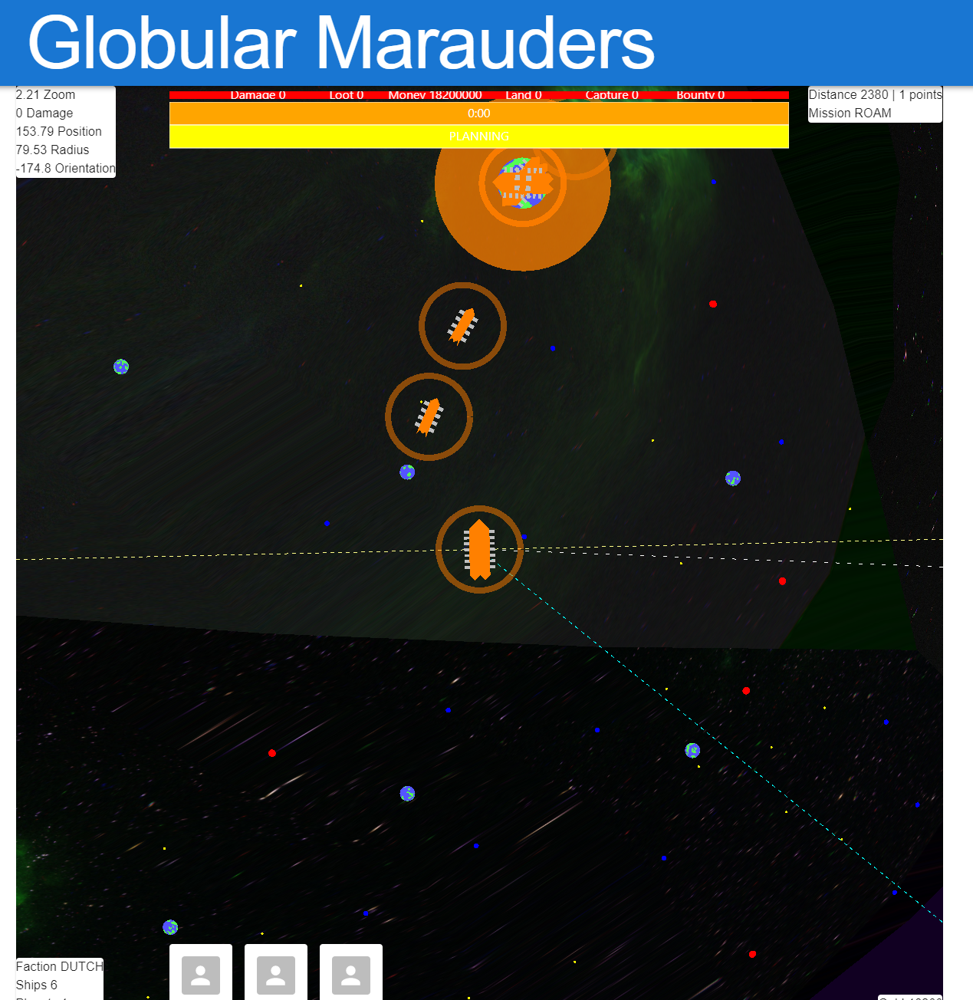
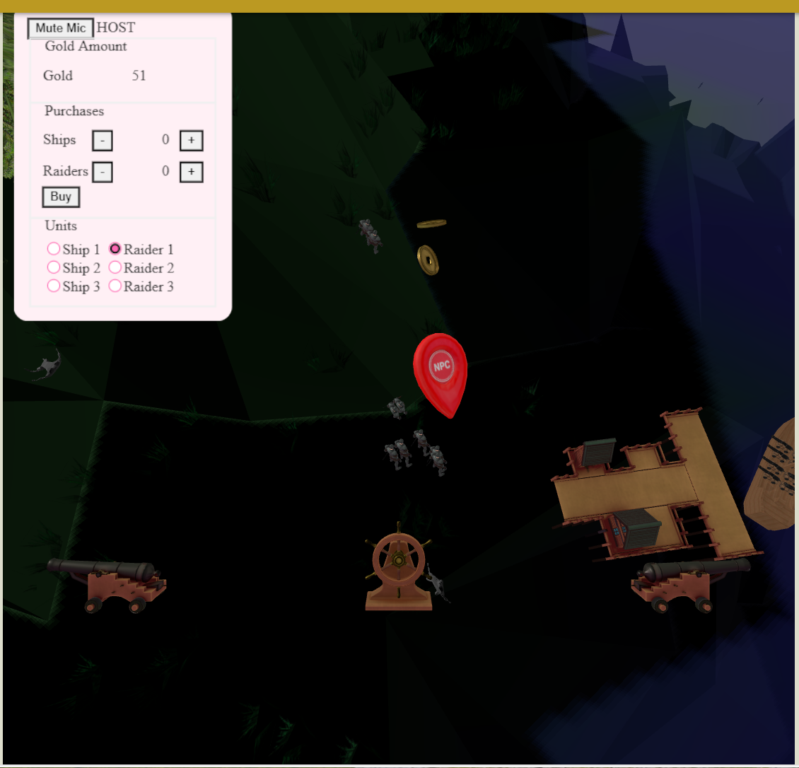
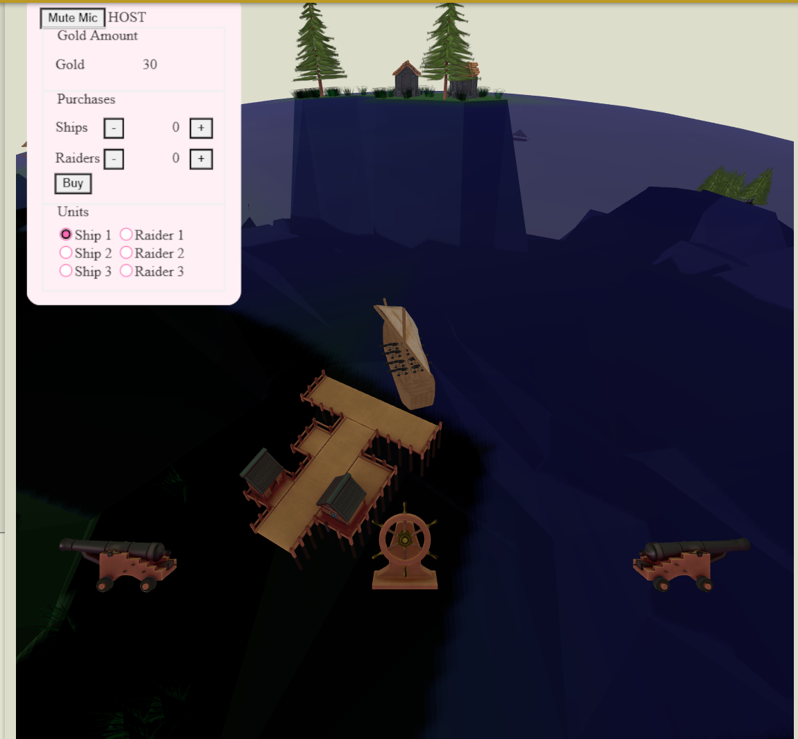

## Play Planet

A 3d planet with ships firing cannon balls and knights marching on the islands attacking villagers. Press WASD to move
ship, QE to aim and fire cannons, F to go back to normal movement mode. You can also click on water to sail to that
position or click on land to move about with knights. The game is also multiplayer so multiple people can fight each
other as long they login with 5 minutes of each other and a maximum of 8 players per room.

The game is available as a live website at [https://playplanet.io](https://playplanet.io)

## Google sign-in on Cloud Run

Google sign-in uses Firebase's redirect flow. For browsers that block third-party storage, serve the app and Firebase auth helpers on the same HTTPS host. Next.js proxies `/__/auth/*` to this project's `tyler-truong-demos.firebaseapp.com` helpers; do not replace this with an HTTP redirect or serve the old static helper files instead. See [Firebase's redirect best practices](https://firebase.google.com/docs/auth/web/redirect-best-practices).

1. In Firebase Authentication, enable the Google sign-in provider and add the app hostname (for example `playplanet.io`) to **Settings → Authorized domains**. Configure the provider's support email.
2. In Google Cloud Console, configure the OAuth consent screen and, for the Google web OAuth client used by Firebase Authentication, add `https://playplanet.io/__/auth/handler` to **Authorized redirect URIs**. Add `https://playplanet.io` to **Authorized JavaScript origins** if required by the client configuration. For an external app in testing, add test users or publish the consent screen.
3. Route the HTTPS hostname to the Cloud Run service, allow unauthenticated access to the service (or configure the load balancer accordingly), and set its container port to `3000`. Ensure the proxy/load balancer forwards `/__/auth/*` to Next.js without intercepting or redirecting it.
4. Build the Docker image with `--build-arg NEXT_PUBLIC_FIREBASE_AUTH_DOMAIN=playplanet.io` and deploy that image to Cloud Run. This value is embedded in the browser bundle at **build time**; changing only Cloud Run runtime environment variables does not change it. The Dockerfile also requires `_GITHUB_ACCESS_TOKEN` for private npm dependencies; supply it through your build system's secret handling, not in source control.

Use the actual app hostname in all three places. For a different Cloud Run URL or staging hostname, register that hostname and its exact `https://HOST/__/auth/handler` URI, then build a separate image with `NEXT_PUBLIC_FIREBASE_AUTH_DOMAIN=HOST` (hostname only, no scheme or path). The Firebase project must match the proxy destination in `next.config.ts`. The production default is `playplanet.io`; visiting the service through another hostname with that build can fail in browsers that block cross-site storage. Test the complete redirect on the deployed HTTPS host, including sign-out and a rejected or cancelled login.

# The game

